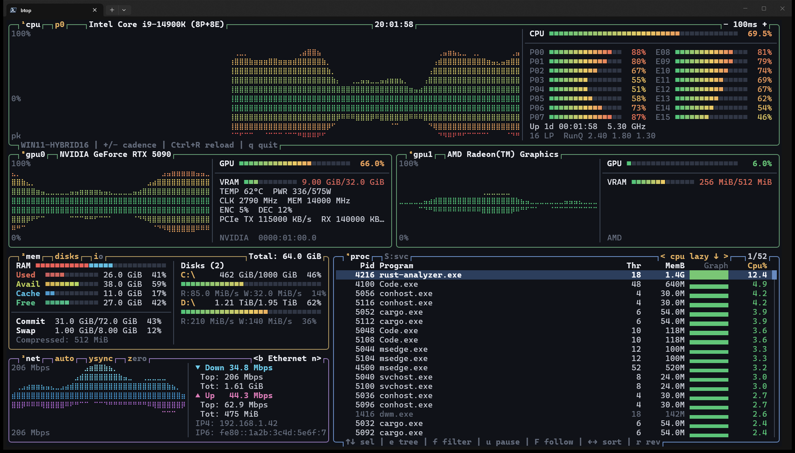
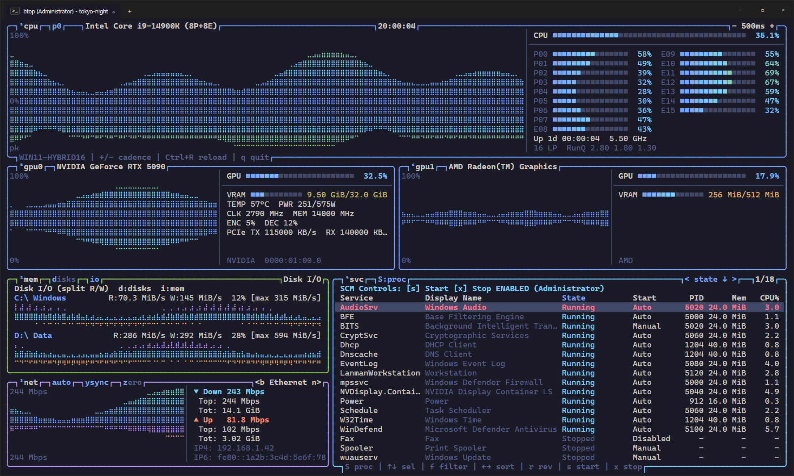
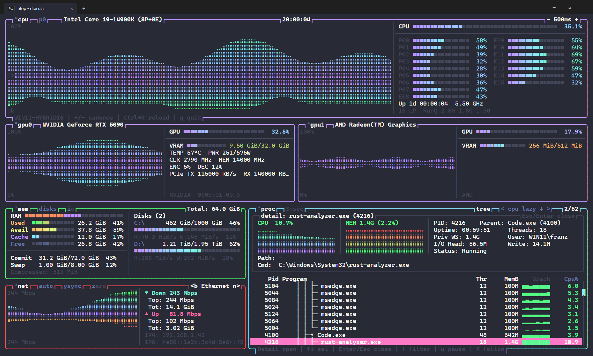
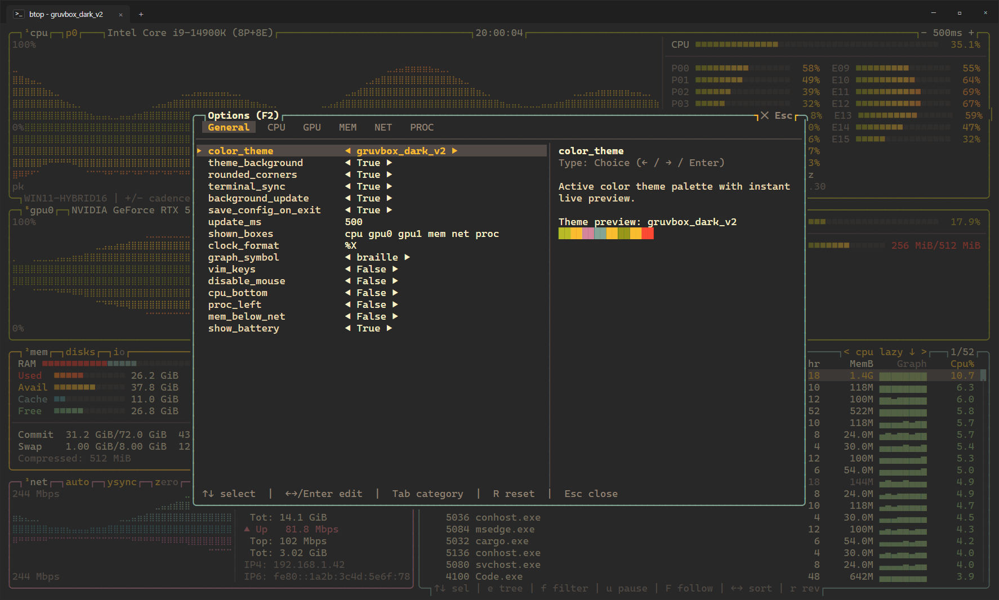

# btop-windows

[](https://github.com/hemsoft-dev/btop-windows/releases/latest)
[](https://github.com/hemsoft-dev/btop-windows/actions/workflows/ci.yml)
[](LICENSE)
[](AGENTS.md)
[](#why-btop-windows)

**Zero kernel drivers. Zero `vc_redist`. One `4.0 MiB` static `btop.exe` for Windows 11.**

`btop-windows` is a native Windows 11 terminal resource monitor written in Rust. It brings modern [btop++](https://github.com/aristocratos/btop) (v1.4.8) panels, 24-bit TrueColor themes, and multi-GPU telemetry to Windows Terminal, together with Windows Services controls and a headless `--json` / `--diagnose` CLI built for scripts and AI agents.



## Quick install

Install `btop.exe` into `%LOCALAPPDATA%\Programs\btop`, verify its SHA-256 checksum, and add `btop` to your User `PATH` with no Administrator prompt and no Visual C++ Redistributable:

```powershell
irm https://raw.githubusercontent.com/hemsoft-dev/btop-windows/main/install.ps1 | iex
```

Then open **Windows Terminal** and run:

```powershell
btop
```

To uninstall later:

```powershell
& ([scriptblock]::Create((irm https://raw.githubusercontent.com/hemsoft-dev/btop-windows/main/install.ps1))) -Uninstall
```

<details>
<summary>Manual portable install</summary>

1. Download `btop-windows-<tag>-x86_64-windows.zip` and `SHA256SUMS.txt` from [GitHub Releases](https://github.com/hemsoft-dev/btop-windows/releases).
2. Verify the SHA-256 hash in PowerShell:

   ```powershell
   Get-FileHash .\btop-windows-<tag>-x86_64-windows.zip -Algorithm SHA256
   Get-Content .\SHA256SUMS.txt
   ```

3. Extract anywhere (for example `C:\Tools\btop`) and run `C:\Tools\btop\btop.exe` in Windows Terminal, or add the folder to your User `PATH`.

</details>

## Why btop-windows

- **Multi-GPU telemetry with zero kernel drivers.** Standard [btop4win](https://github.com/aristocratos/btop4win) has no GPU panels, and its LibreHardwareMonitor build loads `WinRing0`, which demands Administrator privileges and triggers Windows Defender and game anti-cheat (Vanguard, EAC). `btop-windows` renders dedicated multi-GPU boxes (`5`..`0`) across NVIDIA, AMD, and Intel using user-mode DXGI and WDDM PDH, plus automatic `System32\nvml.dll` enrichment on NVIDIA (temperature, watts, power limit, clocks, PCIe TX/RX, encoder/decoder) with no Admin prompt.
- **Built for scripts and AI agents.** Run `btop --json` in any non-interactive shell or agent tool call to get single snapshots, rolled-up process trees, NDJSON streams, time-window `min`/`avg`/`p95`/`max` summaries (`--summary`), deterministic bottleneck diagnostics (`--diagnose`), and a Draft 2020-12 JSON Schema (`--schema`). Every subsystem returns an explicit `DataState` (`available`, `stale`, `warming_up`, `denied`, `unavailable`) instead of fabricating zeros when sensors or protected processes cannot be read.
- **Real Windows 11 workflows.** Toggle into a live Windows Services (`S`) view with Start/Stop controls and PID-joined CPU and memory columns. See hybrid P-core and E-core labels (`GetSystemCpuSetInformation`) and Task Manager utility percentages. Terminate runaway processes safely with `CreateTime` PID-reuse verification and `IsProcessCritical` protection.
- **One small, audited binary.** Written in Rust (`#![forbid(unsafe_code)]` on model, config, and UI), statically linked against the MSVC CRT (`+crt-static`), hardened with `LOAD_LIBRARY_SEARCH_SYSTEM32`, and verified in CI to import only 11 inbox Windows system DLLs. Release artifact size: `4.0 MiB` executable (`1.6 MiB` zip), with 10 Apache-2.0 TrueColor themes compiled directly into `btop.exe`.
- **Deterministic record and replay.** Capture a live session with `btop --record trace.jsonl` and replay it in the TUI or through `--json --diagnose` on any machine with `btop --replay trace.jsonl`.

## Screenshots

### Windows Services (`S`) and split Disk I/O (`i`) in Tokyo Night

Inspect running and stopped Windows Services with live PID-linked memory and CPU usage, control Start/Stop when elevated, and switch the memory panel to split Read/Write Braille disk graphs.



### Process tree (`e`) and process detail overlay (`Enter`) in Dracula

Expand parent/child trees with cycle-free PID creation-time verification and open a live per-process CPU and private working-set detail drawer without leaving the process list.



### Live theme switcher and Options menu (`o` / `F2`) in Gruvbox Dark v2

Browse all 10 embedded Apache-2.0 themes (plus custom `.theme` files) with instant live background preview and inline config editing.



## Comparison

| Capability | `btop-windows` | `btop4win` (v1.0.5) | Task Manager |
| --- | --- | --- | --- |
| Kernel drivers required | **None** | `WinRing0` (LHM build) | None |
| Multi-GPU panels without Admin | **Yes (DXGI + WDDM + NVML)** | No | GUI only |
| Hybrid P/E-core labels | **Yes** | No | No |
| Windows Services view + PID join | **Yes (`S`)** | No | Separate tab, no inline CPU/Mem |
| Guarded kill (`CreateTime` + critical check) | **Yes** | Basic | GUI only |
| Headless `--json`, `--summary`, `--diagnose`, `--schema` | **Yes** | No | No |
| Deterministic `--record` / `--replay` | **Yes** | No | No |
| Runtime dependencies | **0 (`+crt-static`, 11 inbox DLLs)** | External CRT/build | Inbox GUI |
| Upstream `btop++` v1.4.8 UX & themes | **Yes (10 embedded)** | Frozen at v1.0.5 | N/A |

### Honest trade-offs

- **CPU die temperatures and motherboard fan RPMs.** Windows does not expose reliable Intel or AMD CPU die temperatures or motherboard fan sensors in user mode. Because `btop-windows` refuses to bundle `WinRing0`, CPU package temperature and motherboard fans report `unavailable` on most desktops until an optional external sensor bridge is added post-v1.
- **Focused v1 platform target.** `btop4win` supports Windows 10, legacy `conhost.exe`, non-English locales, and >64 logical cores. `btop-windows` v1 targets English Windows 11 (23H2+) x64 in Windows Terminal so the codebase stays fast and small. See [AGENTS.md](AGENTS.md) for the full scope list.

## Headless JSON CLI

Run `btop --json` in PowerShell, CI pipelines, or AI agent tool calls to inspect live Windows 11 telemetry or replay recorded `.jsonl` traces without opening a TTY:

```powershell
# Fast single snapshot of CPU, memory, and GPUs (default 500ms live delta warmup)
btop --json --sections cpu,mem,gpus

# Nested process tree with rolled-up subtree CPU/memory, top 5 roots sorted by CPU
btop --json --sections procs --tree --sort cpu --top 5

# Inspect one PID with verified ancestors and descendants, or filter by !regex
btop --json --sections procs --tree --pid 4216
btop --json --sections procs --filter '!^(cargo|rustc)' --sort mem --top 10

# Filter running Windows Services with linked live process metadata
btop --json --sections services --services-state running --sample-ms 0

# Stream 5 live NDJSON snapshots (0 = stream until Ctrl+C or broken pipe)
btop --json --sections cpu,mem,gpus --count 5 --interval-ms 500

# Capture a 3-second spike summary (min/avg/p95/max + diagnostics)
btop --json --summary --window-ms 3000 --interval-ms 500 --include-series --diagnose

# Print the Draft 2020-12 JSON Schema (all, snapshot, summary, diagnose, error)
btop --schema
btop --schema snapshot
```

<details>
<summary>Example output (abbreviated): <code>btop --json --summary --sections cpu,mem,gpus,procs --top 3 --diagnose</code></summary>

```json
{
  "schema_version": 1,
  "btop_version": "0.2.0",
  "window_ms": 4000,
  "sample_count": 3,
  "hostname": "WIN11-HYBRID16",
  "cpu": {
    "model_name": "Intel Core i9-14900K (8P+8E)",
    "logical_cores": 16,
    "total_busy_pct": { "count": 3, "min": 35.4, "avg": 35.83, "p95": 36.3, "max": 36.3 },
    "freq_mhz": { "count": 3, "min": 5300.0, "avg": 5400.0, "p95": 5500.0, "max": 5500.0 }
  },
  "gpus": [
    {
      "index": 0,
      "name": "NVIDIA GeForce RTX 5090",
      "vendor": "NVIDIA",
      "utilization_pct": { "count": 3, "min": 41.0, "avg": 45.0, "p95": 49.0, "max": 49.0 },
      "power_watts": { "count": 3, "min": 218.0, "avg": 227.5, "p95": 237.0, "max": 237.0 },
      "temp_celsius": { "count": 3, "min": 54.0, "avg": 55.0, "p95": 56.0, "max": 56.0 }
    }
  ],
  "diagnostics": {
    "overall_status": "warning",
    "checks_evaluated": [
      "cpu_saturation",
      "memory_low_available",
      "gpu_vram_pressure",
      "process_subtree_cpu_dominance"
    ],
    "skipped_checks": [
      {
        "check": "cpu_thermal_pressure",
        "category": "cpu",
        "reason": "CPU package temperature sensor unavailable"
      }
    ],
    "findings": [
      {
        "code": "process_subtree_cpu_dominance",
        "severity": "warning",
        "category": "process",
        "summary": "Process subtree rooted at explorer.exe (PID 2048) reached 84.2% p95 CPU in window",
        "evidence": {
          "metric": "process.subtree_cpu_pct.p95",
          "observed": 84.2,
          "threshold": 70.0,
          "unit": "percent",
          "entity": { "pid": 2048, "name": "explorer.exe" }
        }
      }
    ]
  }
}
```

</details>

Exit codes in `--json` mode:

- `0`: Completed cleanly (including `Ctrl+C` or broken pipe during streaming).
- `1`: Runtime error (config, replay file, collector, or stdout I/O), written as `{"schema_version":1,"error":{"code":...,"message":...}}` to stderr.
- `2`: CLI usage or validation error (`code: "cli_usage"` on stderr; plain stderr when `--json` is not active).

## Platform baseline

| Area | Baseline |
| --- | --- |
| Operating system | English Windows 11 (23H2+) x64 (`x86_64-pc-windows-msvc`) |
| Terminal | Windows Terminal (24-bit TrueColor, UTF-8, Cascadia Mono or Nerd Font for Braille/Block graphs) |
| Runtime dependencies | Zero external runtimes (`+crt-static`, audited to 11 inbox Windows system DLLs only) |
| Kernel drivers | Zero (user-mode Win32/NT APIs only; no WinRing0 or Defender friction) |
| Privileges | Non-elevated by default; Administrator required only to Start/Stop Windows Services |
| GPU telemetry | All hardware GPUs via DXGI + WDDM PDH, plus automatic `System32\nvml.dll` enrichment on NVIDIA GPUs |

## Everyday keys and configuration

- **Panels and presets.** `1`..`4` toggle CPU/MEM/NET/PROC, `5`..`0` toggle GPU boxes, `p`/`P` cycle layout presets, `d` toggles disks, `i` toggles Disk I/O mode.
- **Processes and Services.** `e` tree view, `f` filter (`!` prefix for regex), `Enter` detail overlay, `u` pause, `F` follow, `t` graceful close, `k` guarded terminate, `N` priority class, `S` toggle Windows Services view.
- **Menus and themes.** `Esc` / `m` Main menu, `o` / `F2` Options (live `color_theme` switcher), `h` / `F1` Help, `Ctrl+L` force full redraw, `Ctrl+R` reload config, `q` quit. Full mouse click and scroll hit-testing works out of the box, with optional `vim_keys`.
- **Config location.** Place `btop.conf` next to `btop.exe` for portable mode, or let `btop` load and save `%APPDATA%\btop\btop.conf` automatically. Print a starter config with `btop --default-config`.
- **Custom themes.** Searched in `--themes-dir`, exe-adjacent `themes\`, `%APPDATA%\btop\themes`, then the 10 embedded themes (`dracula`, `tokyo-night`, `gruvbox_dark_v2`, `nord`, `onedark`, `kanagawa-wave`, `solarized_dark`, `monokai`, `everforest-dark-medium`, `adwaita-dark`).

## Local development

```powershell
# Build (when needed) and launch btop.exe from the repo root
.\run.ps1

# Helpful run.ps1 options
.\run.ps1 -Build                  # Force a fresh release build
.\run.ps1 -DebugBuild             # Build and run the debug binary
.\run.ps1 -Replay                 # Run against the dual-GPU replay fixture
.\run.ps1 --update 1000           # Forward CLI flags to btop.exe

# Quality gates
cargo fmt --all -- --check
cargo clippy --workspace --all-targets -- -D warnings
cargo test --workspace
```

## Workspace layout

```text
crates/
  btop-sys/       # Hand-written NT/WDK FFI structs, compile-time layout assertions
  btop-model/     # Platform-independent Snapshot, DataState, diagnostics, JSON Schema (no unsafe)
  btop-config/    # btop.conf and .theme parsers, validation, defaults (no unsafe)
  btop-collect/   # Collector trait, pure delta math, Windows collectors
  btop-term/      # Grid, HitMap, VT diff encoder, InputSource, Windows VT console
  btop-ui/        # Pure render(&Snapshot, &History, &UiState, &Config, Size) -> Grid (no unsafe)
apps/
  btop-windows/   # btop.exe CLI (clap), thread wiring, headless JSON mode, startup hardening
docs/
  SPEC.md         # Full functional specification
  ARCHITECTURE.md # System architecture, telemetry matrix, test and CI plan
  PARITY.md       # Upstream btop v1.4.8 config, CLI, keybinding, and theme parity map
  adr/            # Architecture Decision Records
```

## Documentation and contributing

- [Contributing Guide](CONTRIBUTING.md)
- [Domain Glossary](GLOSSARY.md)
- [Agent Instructions (AGENTS.md)](AGENTS.md) and [llms.txt](llms.txt)
- [Functional Specification](docs/SPEC.md)
- [System Architecture](docs/ARCHITECTURE.md)
- [Upstream Parity Matrix](docs/PARITY.md)
- [ADR-0001: Tech Stack, Renderer, and Telemetry Architecture](docs/adr/0001-tech-stack-and-renderer.md)
- [ADR-0002: Windows 11 x64 GPU Baseline API (DXGI + WDDM PDH)](docs/adr/0002-gpu-baseline-api.md)
- [ADR-0003: Cross-Platform Local TUI and `sysinfo` Capability Boundary](docs/adr/0003-cross-platform-local-tui.md)
- [ADR-0004: Pull-Based Tailscale Fleet Agent, `NodeSample` Contract, and Read-Only Boundary](docs/adr/0004-tailscale-fleet-architecture.md)

## License

Licensed under the [Apache License, Version 2.0](LICENSE). See [NOTICE](NOTICE) for upstream `aristocratos/btop` attribution.
